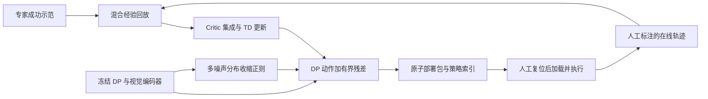

# Panda 齿轮装配：DICE-RL 训练与部署

已实现从已训练 DP、专家示范与人工标注 RL 轨迹，到残差策略更新、恢复训练、导出和真机执行接口的完整流程。
当前数值按用户要求保留为草案，见 [RL_PENDING_VALUES.md](RL_PENDING_VALUES.md)。
`cfg/rl_review.yaml` 仍为 `confirmed: false`；代码验证仅使用模拟设备，没有向 Panda 下发策略动作。

## 代码路线与原项目的对应

参考 `DICE-RL-Robot/dice_rl/model/distill_rl_img.py` 的真机残差分支：



- 冻结基础 DP、视觉编码器及其状态/动作归一化；不使用在线轨迹重新拟合归一化。
- Actor 输入视觉/状态特征与初始噪声，输出归一化残差。最后一层零初始化，首次执行等价于基础 DP。
- 多个 Critic 通过 Huber/MSE TD 损失更新，目标使用随机子集的最小 Q 和 Polyak 目标网络。
- Actor 使用负 Q 损失与同噪声基础 DP 的距离正则；支持 Q 优势过滤、多噪声采样和自模仿项。
- 专家数据使用 reservoir 采样，在线数据使用 FIFO；按配置比例混合组批。
- 采用 `Q(s,a)`，不把无法从专家示范恢复的噪声伪装成已知变量。在线噪声仍留存供审计。

这是面向本项目双 RGB、10 维动作和 Panda 执行器的工程适配，不宣称与原仓库所有可选实验配置逐位一致。
没有额外训练单步网络来替代 DP 采样器；当前残差分支在推理时仍调用冻结 DP。
残差限值使用归一化动作单位：物理位置改变量约为该维动作 half_range 乘以限值；rotation6d 的限值不是弧度。
原工程的可选动力学预测、置信度内在奖励及多候选乐观探索不属于本次默认训练路线。

## 数据与动作块

`rl_dataset.py` 读取原始相邻观测转移，`rl_chunks.py` 将其转换为固定长度块：

| 数据 | 处理方式 |
|---|---|
| 两路图像 | 224×224 RGB；按 checkpoint 所需大小缩放；冻结编码器提取特征 |
| 低维状态 | 实际 XYZ+rotation6d 与实际夹爪总开度 |
| 在线动作 | 每个观测区间中点已生效的实际目标，按策略时钟重采样 |
| 专家动作 | DP 专家 Zarr 的目标动作；仅使用原 DP 的训练分区 |
| 短终止块 | 补齐动作并用 mask 排除无效部分，不跨 episode |
| 时长 | 保留实际观测时长；Critic 同时读取 mask 与各步持续时间 |
| 奖励 | 原始文件保持人工成功/失败标签，learner 按配置映射有效训练奖励 |
| 折扣 | 按 `gamma ** (实际持续时间 / policy_dt)` 计算 |
| 终止 | terminated 不 bootstrap；超时 truncated 保留后继价值 |

在线重采样是对 50 Hz 指令的离散近似，并不还原区间内全部连续动力学。
完整控制指令、原预测计划、噪声、夹爪接受状态均保留在原始 HDF5，不能用整段预测冒充实际执行。
未知初始动作的块、aborted/invalid/partial、保护中止以及未标注轨迹不用于更新。
真实轨迹必须记录基础 DP 哈希和坐标定义；其他基础 DP 的轨迹不会混入。
示范中恒定的动作分量保持冻结，例：始终夹持的夹爪不会凭空学习张开。

## 先跑完全离线检查

使用已经配置好的 `.venv-dp`，从仓库根目录运行：

```bash
cd /home/lhq/dice-rl
my_dice_rl/.venv-dp/bin/python -m my_dice_rl.script.check_rl_pipeline \
  --output /tmp/dice_rl_check_new --device cpu
```

输出目录必须为空。该命令会创建独立的模拟示范、小 DP、三条 RL 轨迹和少量 RL 更新，验证恢复、导出与再次模拟执行。
所有产物标记 simulated，真实执行入口会拒绝加载。它验证代码链路，不衡量装配成功率。
也支持 `--device cuda:0`；使用 GPU 前应确认资源空闲，正式 learner/执行器通过同一个 device lock 协调。

## 正式流程：数值确认后使用

1. 用已有示范处理与 DP 训练代码生成正式 checkpoint，`task.allow_demo=false`。
2. 让 `cfg/finetune/train_dice.yaml` 的 `teacher_checkpoint`、`expert_dataset` 对应该 DP 和同一份专家 Zarr。
3. 按 [待确认表](RL_PENDING_VALUES.md) 填写 `cfg/rl_review.yaml`，核对执行限制后将 `confirmed` 设为 true。
4. 按 [阻抗控制启动说明](README_impedance_control.md) 启动 Panda/Hand、状态发布器和阻抗控制器。
5. 先使用基础 DP 采集若干条人工标注的 RL 轨迹，再启动 learner。

执行界面启动命令（在 `my_dice_rl` 目录）：

```bash
bash script/execute_rl.sh --checkpoint /你的正式DP目录/checkpoint/best.pt
```

流程仍为人工复位 → 3 确认就绪 → 4 执行 → Esc 停止 → 5 成功 / 6 失败 / 7 放弃。
齿轮从已夹持状态开始，不会自动复位。窗口最初保持暂停。
两台相机已启动时加 `--no-cameras`；外部遥操作节点必须支持项目的 policy_lock 服务。

独立终端启动 learner：

```bash
cd /home/lhq/dice-rl/my_dice_rl
bash script/train_rl.sh --watch \
  --set teacher_checkpoint=/你的正式DP目录/checkpoint/best.pt \
        expert_dataset=/你的专家数据/gear_insertion.zarr
```

- `--watch` 等待新增完整、已标注的轨迹，满足最小数据量后进行一轮更新。
- 不带 `--watch` 时，从已有数据离线更新到 `total_updates`；缺少有效在线数据会明确报错。
- learner 不启动 ROS，不控制夹爪或复位。训练默认使用4090，回放存于 CPU。
- 相同 `device_lock` 防止训练更新与执行占用 GPU 的时段重叠。执行持锁直到本轮结束和迟到推理退出。
- learner 更新时 4 可能提示等待 GPU；已经开始的执行不会被训练抢占。
- 修改架构、优化器或回放语义后应开始新 run，恢复入口会拒绝不匹配设置。

## 更新权重与部署

每轮更新生成：

```text
log_dir/finetune/gear_dice/<run>/
├── config.yaml
├── metrics.jsonl
├── checkpoint/last.pt       # 模型、目标网络、优化器、RNG、回放与数据清单
├── policy/step_XXXXXXXX.pt  # 内嵌冻结 DP 与残差 Actor 的不可变部署包
└── latest_policy.json      # 原子索引，含部署包哈希
```

在界面回到“待人工复位”后，用“加载 DP / RL 策略”选择 `latest_policy.json`。
运行途中加载请求会被拒绝。修改索引不会改变已经加载到内存中的策略。
重新人工复位、确认就绪、开始执行后，采集到的轨迹可供下一轮更新。

也可以显式导出某个训练 checkpoint：

```bash
cd /home/lhq/dice-rl
my_dice_rl/.venv-dp/bin/python -m my_dice_rl.script.export_rl_policy \
  --checkpoint /你的RL目录/checkpoint/last.pt \
  --output /你的部署目录/policy_step00100.pt
```

已有输出文件不会覆盖。正式导出要求真实来源、已训练权重、已确认参数及完整必填项。
只有 Critic 热身、Actor 尚未更新的包也不能用于真机；这段时间继续用基础 DP 采集。
模拟检查可加 `--allow-draft`，产生的模拟/未确认包仍不能用于真机。
部署包内嵌基础 DP、编码器与归一化；迁移部署文件不依赖原始 DP 文件路径。
真机加载还会核对任务、TCP、基坐标、确认表哈希及执行限制；修改这些设置后应重新导出。

```bash
cd /home/lhq/dice-rl/my_dice_rl
bash script/execute_rl.sh --checkpoint /你的部署目录/policy_step00100.pt
```

继续训练：

```bash
bash script/train_rl.sh --resume /你的RL目录/checkpoint/last.pt --watch
```

恢复需要保留对应的专家数据和已收集轨迹。已有轨迹若被修改，恢复/新增数据检查会报错，不静默重复导入。
checkpoint 保存 Replay 与 RNG，包含未完成训练轮的目标步数；相同设备、配置和数据下可以复现下一次更新。
训练损失不是装配成功率，程序不把最低训练损失命名为“最佳真机策略”。应通过人工标注的独立评估确认效果。

## 参数与限制

- 参数总表：[RL_PENDING_VALUES.md](RL_PENDING_VALUES.md)。
- 成功标准已确定为齿轮插入即可（约 15 mm），由操作员人工标注，成功奖励 1、失败奖励 0。插入深度是人工判断参考，不自动检测；数值容差可留空，保持时间为 0 表示不要求额外保持。
- 文件总表：[RL_IMPLEMENTATION_FILES.md](RL_IMPLEMENTATION_FILES.md)。
- 力/力矩、跟踪误差、预测目标范围和夹爪取消确认继续由已有执行器负责；本次没有修改硬件控制参数。
- review 中的质量/质心和复位定义是人工确认记录，不自动执行 Desk 配置、载荷辨识或物理复位。
- 当前尚无正式数据训练的 RL checkpoint，也没有真机装配成功率验证；需要先完成数值确认与正式数据准备。
